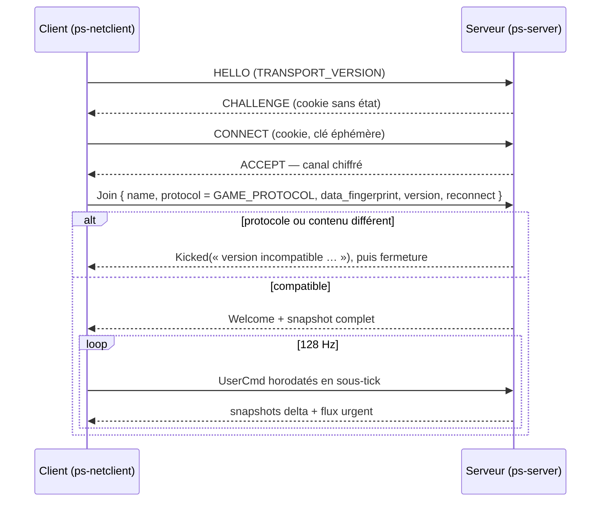

# Contrats de communication

Chaque contrat a :
- un seul propriétaire, la crate qui le définit ;
- une constante de version ;
- des tests de sérialisation dans le dépôt propriétaire.

Les composants ne partagent jamais de structures internes : ils échangent uniquement ces types.

| Communication | Transport | Contrat | Version | État |
|---|---|---|---|---|
| Client ↔ Server (jeu) | UDP chiffré, 4 canaux | `ps-transport` (poignée de main, chiffrement, fiabilité) + `ps-sim-net::proto` (messages de jeu, snapshots delta, flux urgent) | `TRANSPORT_VERSION = 1`, `GAME_PROTOCOL = 1` | **implémenté** |
| Contenu partagé client/serveur | fichiers | `Project-s-content/manifests/content.toml` (format 1, sha256 par fichier, `data_fingerprint`) | `format = 1`, contenu `0.1.0` | **implémenté** |
| Replays | fichier `.psrp` | `ps-replay` (conteneur), `ps-sim-net::record` (contenu) | `FORMAT_VERSION = 1` | **implémenté** (enregistrement, relecture en test ; aucun lecteur dans le client) |
| Exploitation du serveur | HTTP local (127.0.0.1), jeton Bearer | `/health`, `/metrics` (Prometheus), `/status`, `/command` ([deployment.md](https://github.com/SforSkill/Project-s-server/blob/main/docs/deployment.md)) | non versionné (outil local) | **implémenté** |
| Client → Core | HTTPS | authentification, sessions, matchmaking : `ps-core-protocol::{matchmaking, error}` | `PROTOCOL_VERSION = 1.0` (`ps-types`) | contrat défini, **service prévu** |
| Notifications client | WebSocket | `ps-core-protocol::events::EventEnvelope` | `ENVELOPE_VERSION = 1` | contrat défini, **service prévu** |
| Core → Server | ticket signé, porté par le client | `ps-core-protocol::ticket::TicketClaims` (Ed25519, `PS-TICKET-V1\0`) | `TICKET_VERSION = 1` | contrat défini ; **vérification non implémentée** dans le serveur |
| Server → Core | API asynchrone, hors du tick | `ps-core-protocol::{heartbeat, results}` | `HEARTBEAT_INTERVAL_MS = 5000`, timeout 20 000 | contrat défini, **prévu** |
| Core → Orchestrator | API authentifiée | à définir dans `ps-core-protocol` quand l'orchestrateur existera | — | **prévu** |
| Orchestrator → Node | canal authentifié | à définir | — | **prévu** |
| Server → Anti-cheat | événements + preuves en stockage objet | `ANTICHEAT_EVIDENCE_CREATED` (`object_key`, détecteur, version, confiance) | `ENVELOPE_VERSION = 1` | contrat défini, **prévu** |
| Admin → Core | HTTPS | API d'administration du Core | — | **prévu** |

Détail des contrats du back-end : [contracts.md](https://github.com/SforSkill/Project-s-protocol/blob/main/docs/contracts.md). Détail du transport : [network.md](https://github.com/SforSkill/Project-s-netcode/blob/main/docs/network.md). Format des replays : [replay-format.md](https://github.com/SforSkill/Project-s-protocol/blob/main/docs/replay-format.md).

## Poignée de main client ↔ serveur

## Ticket de connexion (mode officiel, prévu)

1. Le Core vérifie le compte (Trust : pas de bannissement actif), réserve le joueur sur un match, puis émet `TicketClaims { version, ticket_id, account_id, session_id, match_id, server_id, team, ranked, game_protocol, issued_at, expires_at }`, valable quelques dizaines de secondes, enveloppé dans `SignedTicket { claims, key_id, signature }`.
2. Il signe `SIGNING_CONTEXT || JSON(claims)` avec sa clé privée Ed25519. **La clé privée ne quitte jamais le Core.**
3. Le client transmet le ticket au serveur dans `Join`. Ce champ n'existe pas encore. Il sera optionnel, puisque le mode communautaire s'en passe, mais il change le format sur le fil : `GAME_PROTOCOL` passera donc à 2.
4. Le serveur vérifie la signature avec la clé publique `key_id` (configuration du serveur), puis `validate_for_match(server_id, match_id, now)`. Un ticket ne vaut que pour un seul match sur un seul serveur, avec au plus `MAX_CLOCK_SKEW_MS = 5000` de décalage d'horloge.

Cette vérification se fera à la connexion, jamais dans la boucle de tick. La révocation en cours de partie passera par l'événement `PLAYER_SESSION_REVOKED` ou `PLAYER_BANNED`, poussé au serveur par le Core.

## Règles de compatibilité

- Ajouter un champ : il doit être optionnel. C'est une version mineure.
- Retirer, renommer ou changer le type d'un champ : c'est une version majeure, avec une entrée `BREAKING` au changelog. Un nom retiré n'est jamais réutilisé.
- Messages de jeu (`GAME_PROTOCOL`) et transport (`TRANSPORT_VERSION`) : client et serveur doivent avoir **exactement** la même valeur. Toute modification du format sur le fil incrémente la constante.
- Modifier un message secondaire de `ps-core-protocol` n'oblige pas à recompiler la simulation ni le client : la simulation n'en dépend pas (règle vérifiée par `boundaries.toml`).
