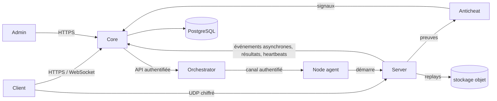

# Architecture de Project S

## Principe

Une seule simulation autoritaire, écrite en Rust pur et sans E/S. Elle vit dans [Project-s-simulation](https://github.com/SforSkill/Project-s-simulation) et s'exécute à trois endroits, toujours avec le même code de mouvement et de collision :
- dans le serveur dédié ([Project-s-server](https://github.com/SforSkill/Project-s-server)) ;
- dans le serveur embarqué du client, pour le jeu local : même boucle UDP 128 Hz sur 127.0.0.1 ;
- en partie dans le client, qui prédit son propre déplacement (`ps-sim-net::predict`).

Le rendu (Bevy 0.20 + egui, client et [Project-s-engine](https://github.com/SforSkill/Project-s-engine)) ne contient aucune règle de jeu. Il affiche l'état fourni par `ps-netclient` et produit des `UserCmd`.

Les frontières entre dépôts ne sont **pas** des frontières réseau. Les bibliothèques techniques (simulation, netcode, moteur, protocole) sont liées dans le processus qui les utilise : aucun appel HTTP ni sérialisation supplémentaire n'a été ajouté dans le chemin critique.

```mermaid
flowchart LR
  subgraph C[Client Project-s]
    UI[ps-client<br/>Bevy, HUD, menus, entrées] -->|UserCmd| NC[ps-netclient<br/>prédiction, interpolation,<br/>extrapolation, horloge]
    NC -->|état| UI
    ENG[ps-engine-character<br/>personnages, shader] --- UI
    LS[ps-server embarqué<br/>jeu local] -.127.0.0.1.- NC
  end
  subgraph S[Serveur dédié Project-s-server]
    SRV[ps-server<br/>boucle 128 Hz, PIM,<br/>snapshots delta, flux urgent,<br/>replays] --> SIM[ps-sim<br/>mouvement, armes, hitreg,<br/>grenades, fumée, bombe,<br/>bots, règles]
    ADM[admin HTTP locale<br/>/health /metrics /status /command]
  end
  NC <-->|UDP chiffré ps-transport| SRV
  SRV -.hors du tick.- ADM
  CT[(Project-s-content<br/>configs, cartes, manifeste)] --> UI
  CT --> SRV
```

## Couches

| Couche | Dépôt | Peut dépendre de |
|---|---|---|
| Contrats | Project-s-protocol | rien d'interne |
| Transport | Project-s-netcode | rien d'interne |
| Simulation | Project-s-simulation | protocole (`ps-types`, `ps-replay`), transport (`ps-sim-net` seulement, pour le codec) |
| Moteur de présentation | Project-s-engine | rien d'interne (générique, Bevy seulement) |
| Applications | Project-s (client), Project-s-server | simulation, transport, protocole, moteur (client seulement), contenu (données, pas de code) |
| Données | Project-s-content | simulation, pour la validation et la génération des cartes |
| Services centraux (prévus) | Core, orchestrateur, anti-triche, admin | `ps-core-protocol`, jamais la simulation ni le moteur |

Le graphe exact est dans [DEPENDENCY_GRAPH.md](DEPENDENCY_GRAPH.md), le rôle de chaque dépôt dans [REPOSITORY_MAP.md](REPOSITORY_MAP.md).

## Temps

- Le serveur tourne à un tick fixe : 128 Hz par défaut (`--tick`). Le laboratoire mesure aussi 256 Hz.
- Les entrées sont horodatées en sous-tick (`ButtonEvent.frac`, de 0 à 255). La cadence de tir et le contre-strafe ne dépendent donc ni du FPS ni du tick.
- `UserCmd::view_time` donne le temps de rendu que voyait le joueur. Le serveur rembobine les hitboxes jusqu'à ce temps, dans la limite de `LagCompPolicy` : 200 ms au plus, 50 ms de tolérance.
- La boucle à 128 Hz n'attend jamais une E/S HTTP, SQL, disque ou objet. L'administration, les métriques et l'écriture des replays restent hors du tick.

## Modes du serveur

| Mode | État | Description |
|---|---|---|
| Communautaire | **implémenté** | Hébergement libre, configuration TOML, administration locale (jeton Bearer), bannissements locaux, aucun résultat officiel. C'est le mode actuel du serveur dédié et du jeu local. |
| Officiel | **prévu** | Tickets signés par le Core, bannissements globaux, résultats officiels, reconnexion, remontée des preuves. Les contrats existent dans `ps-core-protocol` ; le serveur ne les applique pas encore ([docs/planned/core.md](docs/planned/core.md)). |

## Écosystème cible



Seules les flèches Client ↔ Server existent aujourd'hui. Le reste est spécifié dans [API_CONTRACTS.md](API_CONTRACTS.md) et [docs/planned/](docs/planned/).

## Décisions

[docs/decisions/](docs/decisions/), et en particulier [ADR 0007](docs/decisions/0007-multi-repository.md), qui justifie le découpage en dépôts.
