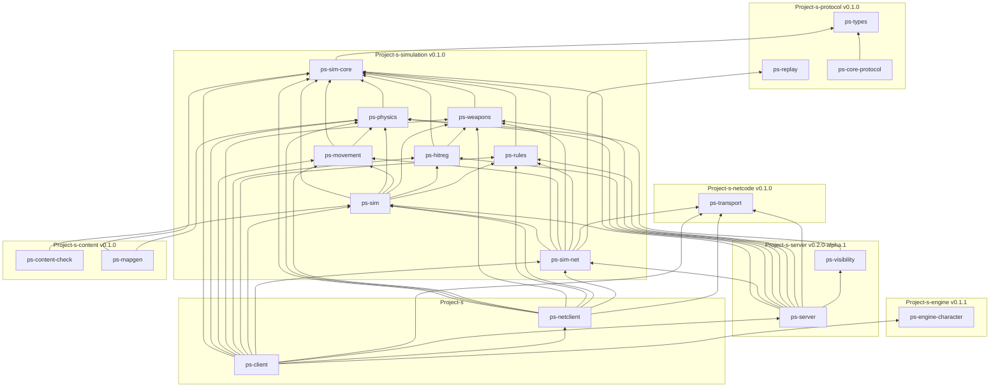
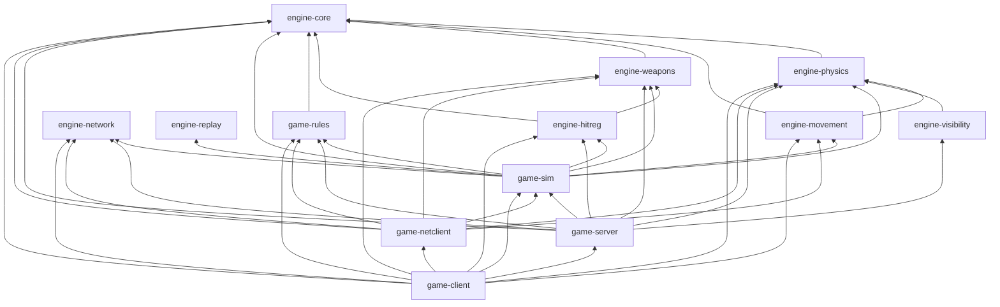

# Graphe des dépendances

Seules les dépendances Cargo figurent ici. Les échanges HTTP, UDP ou par événements entre services ne sont pas des dépendances Cargo : ils sont décrits dans [API_CONTRACTS.md](API_CONTRACTS.md).

Dans un même dépôt, une crate dépend de ses voisines par chemin (`path`). D'un dépôt à l'autre, elle passe par une dépendance Git épinglée sur un **tag** immuable ([VERSIONING.md](VERSIONING.md)).

## Après migration (v2026.11-alpha.1)

Graphe extrait des `Cargo.toml` publiés le 27/11/2026. Seules les dépendances normales y figurent (pas celles de développement).

`ps-client` dépend de la bibliothèque `ps-server` **sans** sa feature `admin` (sans tokio, axum ni Prometheus). C'est ce qui permet le jeu local : serveur embarqué sur 127.0.0.1, même code que le serveur dédié ([ADR 0007](docs/decisions/0007-multi-repository.md)). Le client ne dépend jamais du binaire dédié.

Arêtes = dépendances directes normales (relevées dans les `Cargo.toml` du 27/11/2026). `ps-netclient` ne dépend de `ps-server` qu'en dépendance de test, pour ses tests de bout en bout.

## Règles

| Règle | Où elle est vérifiée |
|---|---|
| Le protocole ne dépend d'aucun composant métier, ni d'un runtime async, ni d'un client SQL | `Project-s-protocol/boundaries.toml` |
| La simulation ne dépend ni du rendu, ni d'un runtime async, ni de HTTP, ni d'une base de données, ni des contrats du Core | `Project-s-simulation/boundaries.toml` |
| Le netcode ne connaît ni le jeu, ni Bevy, ni le Core | `Project-s-netcode/boundaries.toml` |
| Le moteur ne connaît ni les règles de Project S, ni le réseau, ni le Core | `Project-s-engine/boundaries.toml` |
| Le serveur est headless : ni Bevy, ni wgpu, ni winit, ni egui, ni audio, ni code client, ni SQL | `Project-s-server/boundaries.toml` |
| Le contenu ne dépend ni du rendu, ni du réseau, ni du serveur | `Project-s-content/boundaries.toml` |
| Le client n'accède jamais à une base de données, et n'active jamais l'API d'administration du serveur | `Project-s/boundaries.toml` |
| Pas de cycle entre crates `ps-*` | `tools/check_boundaries.py` |
| Toute dépendance directe `ps-*` est déclarée dans la liste `internal` de la crate | `tools/check_boundaries.py` |
| Sources Git limitées aux dépôts SforSkill, licences autorisées, vulnérabilités connues | `deny.toml` de chaque dépôt (`cargo-deny`) |

`check_boundaries.py` parcourt le graphe **transitif** résolu par `cargo metadata --locked`. Une dépendance interdite qui entre par une crate intermédiaire est donc détectée. La CI l'exécute sur chaque PR, via le job `rust / boundaries`.

## Avant migration (Projet-S, commit `b586317`)

Un seul workspace de 13 crates, plus 2 outils (`tools/mapgen`, `tools/netlab`).

Les problèmes relevés dans ce graphe sont détaillés dans [ARCHITECTURE_AUDIT.md](ARCHITECTURE_AUDIT.md) :
- `game-sim` mêlait simulation, codec réseau et enregistrement de replays ;
- les préfixes `engine-` désignaient des crates de simulation, pas le moteur de rendu ;
- les contrats du back-end n'existaient pas ;
- aucune règle de frontière n'était vérifiée.
