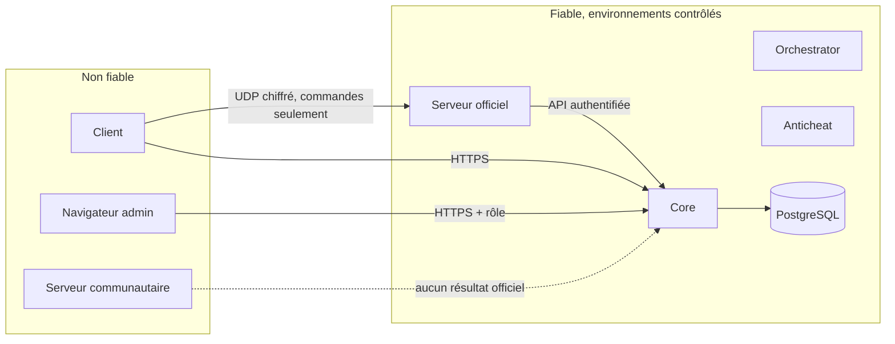

# Frontières de sécurité

Le client et tout frontend sont considérés comme **non fiables**. Seuls les serveurs officiels et les services centraux sont des frontières de confiance.

## Règles

| Règle | Application actuelle | Vérification |
|---|---|---|
| Le serveur est autoritaire : le client n'envoie que des `UserCmd` et des intentions (achat, équipe), jamais un état | **implémenté** (`ps-server` valide et simule tout) | tests de simulation et de bout en bout |
| Trafic de jeu chiffré, anti-rejeu, cookie sans état contre l'usurpation d'adresse | **implémenté** (`ps-transport`) | tests de `ps-transport` |
| Un joueur ne reçoit que les positions qu'il peut bientôt voir (anti-wallhack) | **implémenté** (`ps-visibility`, PIM) | tests de `ps-visibility` |
| Compensation de latence bornée (200 ms, tolérance 50 ms) | **implémenté** (`ps-hitreg`, `LagCompPolicy`) | tests de `ps-hitreg` |
| API d'administration sur la boucle locale, jeton Bearer depuis l'environnement, comparaison en temps constant | **implémenté** | CI Docker : `/status` sans jeton → 401 |
| Aucun secret versionné : jetons et clés via l'environnement ou un gestionnaire de secrets ; `.env`, `*.pem` et `*.key` dans `.gitignore` | **appliqué** | revue ; scan de secrets dans la CI de Project-s-infra |
| Aucune clé privée de signature dans le client ni dans le serveur : le Core signe, le serveur ne détient que des clés publiques | contrat défini (`ps-core-protocol::ticket`) | — (Core prévu) |
| Ticket limité à un compte, un match et un serveur, valable quelques dizaines de secondes | contrat et tests (`ticket_opens_only_its_server_and_match`, `ticket_expires`) | tests de Project-s-protocol |
| Un joueur banni n'obtient pas de ticket officiel, et un serveur officiel refuse une connexion sans ticket | **prévu** (mode officiel) | — |
| Un serveur communautaire ne produit jamais de résultat classé | appliqué par construction : aucun envoi de résultat n'est implémenté | — |
| Le client n'a aucun accès SQL, et n'active pas l'API d'administration du serveur embarqué | **implémenté** | `boundaries.toml` du client |
| Règles de détection de l'anti-triche jamais distribuées dans le client | **prévu** : Project-s-anticheat sera privé, et le client ne contient aucun détecteur | — |
| Pas d'anti-triche noyau | décision | — |
| Dépendances : vulnérabilités connues, licences, sources Git limitées à SforSkill | **implémenté** | `cargo-deny` (job `rust / deny`) |
| Services durcis (utilisateur dédié, `NoNewPrivileges`, système de fichiers en lecture seule, conteneur non root) | **implémenté** | `systemd-analyze verify` et image Docker en CI de Project-s-server |

## Dépôts publics

Les dépôts publics ne contiennent :
- ni secret ;
- ni paramètre de détection ;
- ni configuration de production.

Ils contiennent ce que le binaire du client révèle de toute façon : simulation, protocole, transport. Le modèle de sécurité n'en dépend pas : la sécurité repose sur l'autorité du serveur, pas sur le secret du code.

Les dépôts privés (lab, infra, et les futurs Core, orchestrateur, anti-triche, admin) le restent. Rendre un dépôt public demande une décision explicite du propriétaire de l'org.

## Signaler une vulnérabilité

Dans le dépôt concerné : **Security → Report a vulnerability** (avis privé). Jamais d'issue publique.

Modèle de menace détaillé du serveur : [Project-s-server/docs/security.md](https://github.com/SforSkill/Project-s-server/blob/main/docs/security.md).
